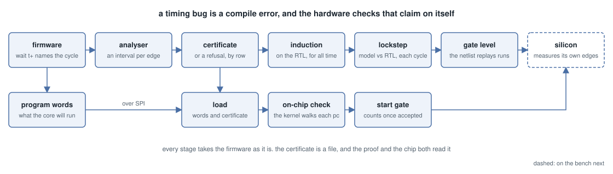

# protocol-emulator

A small chip that bit-bangs protocols from firmware, and won't start any firmware whose
timing it can't prove. Written in Hardcaml for Jane Street's protocol emulator ASIC
competition, built on IHP CMOS5L through Tiny Tapeout, in 8 x 4 tiles at 48 MHz.

Two small cores drive the pins from firmware, much like the RP2040's PIO. The difference is
time. Each core has a 24-bit clock, a deadline register `t` and a period `p`. `wait t+`
releases on the exact cycle of the deadline and moves it on by one period, so a frame never
drifts. A UART bit or an I2C hold time is a deadline written in the program, not a count of
instructions you hope adds up.

A small kernel checks a certificate of each program's timing and refuses anything it can't
check. The kernel is proved against the RTL. If it accepts a program, that program never
misses a deadline on the chip, under the assumptions in [Verification](docs/verification.md#what-is-not-proved).

The chip runs that check itself. Before it lets an engine start, it walks the program
against its certificate, and it refuses the start if the walk fails. If a deadline is ever
missed anyway, the engine lets go of its pins and halts, and that is proved too. The chip
also takes USB full speed packets off the pins into the data memory with their CRCs
checked, and 10BASE-T frames when clocked at 40 or 50 MHz.

| | | Source |
|---|---|---|
| Process | IHP SG13CMOS5L through Tiny Tapeout, 8 x 4 tiles | `info.yaml`, `.github/workflows/gds.yaml` |
| Clock | 48 MHz | `info.yaml` |
| Cores | 2 cores, 3 IHP 512 x 16 SRAM macros: a program memory each and a data memory they share | `src/protocol_emulator.v` |
| Pins | 4 for the host's SPI, 5 in, 7 out, 8 bidirectional, and 8 wires between the cores | `info.yaml`, `src/isa.ml` |
| Hardened | 47,958 standard cells at 65.7% utilisation, setup slack +4.034 ns at the slow corner, hold slack +0.019 ns, precheck clean | gds run [42268510223](https://github.com/MarcosAsh/protocol-emulator/actions/runs/42268510223) |
| Firmware | 68 library firmwares the kernel accepts | `test/test_kernel.ml` |
| Proved | a program the kernel accepts never misses a deadline on each core's RTL, under the assumptions below | `formal/phase_table.sby`, `formal/phase_table_affine.sby` |
| Board | the 8 x 4 RTL on an Icepi Zero (ECP5 FPGA): all 21 bench demos PASS, self-timing and USB keyboard included, witnesses recorded 2026-11-03. No silicon yet | `test/board/` |

## Try it

No install: the [playground](https://marcosash.github.io/protocol-emulator/playground/) runs
the kernel in your browser. Paste firmware and it accepts or refuses it, and says why.

## Docs

The [site](https://marcosash.github.io/protocol-emulator/) has the rest:

- [Getting started](docs/getting-started.md)
- [Run it on the board](docs/lab.md)
- [Architecture](docs/architecture.md)
- [Datasheet](docs/datasheet.md)
- [Compared with PIO and PRU](docs/comparison.md)
- [Protocols](docs/protocols.md)
- [Verification](docs/verification.md)
- [Flexibility](docs/flexibility.md)
- [How AI was used](docs/ai-use.md)
- [Hardware](docs/hardware.md)
