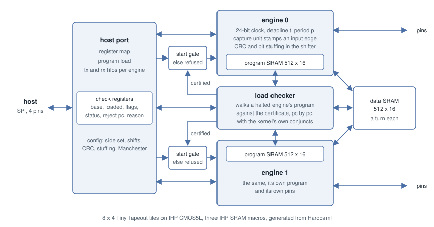

# Architecture



The host talks to the chip over SPI on 4 pins. Each of the two engines runs its own program
from its own 512 x 16 SRAM, and the two take turns at a data SRAM they share. The
[datasheet](datasheet.md) has the instruction set, the pins and the host's registers.

## Deadlines

Each core has a 24-bit clock, a deadline register `t` and a period `p`. `wait t+` releases
on the exact cycle of the deadline and moves it on by one period, so a frame never drifts.
A UART bit or an I2C hold time is a deadline written in the program, not a count of
instructions you hope adds up.

## The kernel

Before a program is loaded, a small kernel checks a certificate of its timing and refuses
anything it can't check. `src/kernel.ml` is a checker you can read in one sitting. What it
guarantees, and under which assumptions, is on [Verification](verification.md).

## One piece of Hardcaml, two uses

The deadline compare is the heart of the timing, and it is this, from `src/deadline.ml`:

```ocaml
module Make (Comb : Comb.S) = struct
  open Comb

  let phase ~now ~t = now -: t
  let release ~now ~t = ~:(msb (phase ~now ~t))
  let late ~now ~t = release ~now ~t &: (phase ~now ~t <>:. 0)
end
```

The engine builds it from `Signal`, so it becomes gates on the chip. `test/test_deadline.ml`
builds the same functor from `Comb_gates` and has a SAT solver prove, for every value of the
clock and the deadline, that release means `now - t >= 0` as a signed number, wrapping and
all. The chip and the proof can't drift apart because they are the same code.
