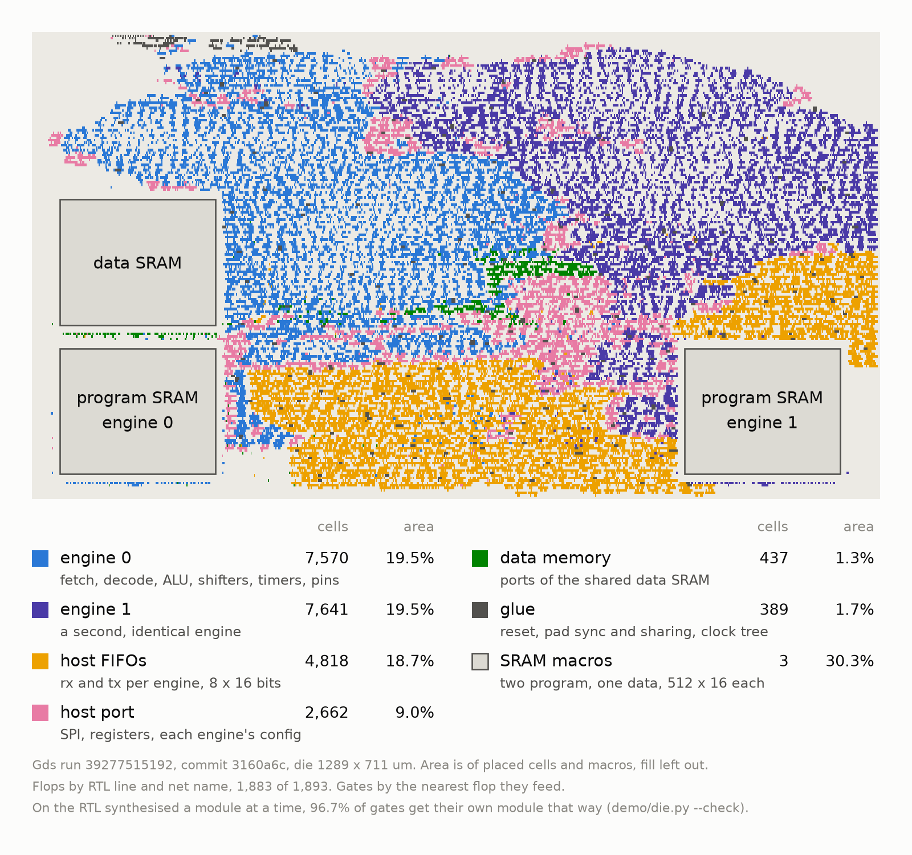

# Hardware

Nothing has run on silicon yet. The chip's RTL runs on an Icepi Zero FPGA, and the bench
measures it there. What passed on the board is on
[Verification](verification.md#what-is-not-proved).

## Harden

To harden, clone TinyTapeout/tt-support-tools, branch `ihp-sg13cmos5l`, into `tt/`, then
`tt/tt_tool.py --create-user-config --ihp` and `--harden --ihp`. Gds run 39277515192, on
this Verilog, signs off with setup slack +3.487 ns at the slow corner against a 50 MHz clock, at 49.6%
utilisation. The picture is this harden's die by RTL module, drawn by `demo/die.py` from its
`GDS_logs` artifact. 1,883 of 1,893 flops map by RTL line and net name. Each gate goes with
the nearest flop it feeds, which gets 96.7% of gates right on the RTL synthesised a module at
a time (`--check`).

The [live die](https://marcosash.github.io/protocol-emulator/die/) lights the cells and
wires as they switch. The last green gds run on main is also in Tiny Tapeout's
[GDS viewer](https://gds-viewer.tinytapeout.com/?pdk=ihp-sg13cmos5l&model=https%3A%2F%2Fmarcosash.github.io%2Fprotocol-emulator%2Ftinytapeout.oas).

## Icepi Zero

`make -C icepi` builds the chip for an Icepi Zero (ECP5 LFE5U-25F) with yosys and nextpnr:
its 50 MHz oscillator through the PLL to 48 MHz, or 40 MHz for 10BASE-T, and the pins on
the 40-pin header. The SRAM macro is its IHP behavioural model, mapped to block RAM. 48 MHz
is tight and about 1 seed in 8 fails, so the build takes the first seed that meets timing.
`make -C icepi equiv` proves the bitstream's netlist equal to the RTL (`formal/icepi_equiv`,
the `icepi_equiv` job).

## Bench

The bench has one permanent wiring, the carrier PCB's. The PCB is
[protocol-emulator-bench](https://github.com/MarcosAsh/protocol-emulator-bench), KiCad,
CERN-OHL-P v2. `src/bench_wiring.ml` says which logic analyser channel each chip pin
reaches. `demo/bench_run.py` runs one bench demo unattended: it loads the chip, runs
`demo/outside.sh`, measures the capture against the datasheet limits and keeps the
evidence. `test/test_outside.py` runs the same demos' Python on the RTL at the bench's
48 MHz and decodes the pins with the sigrok decoders the bench uses.

## Downloads

[Release v0.4.0](https://github.com/MarcosAsh/protocol-emulator/releases/tag/v0.4.0) has
`generate-linux-x86_64`, the Icepi Zero and UP5K bitstreams, and the chip's GDS and render.
Release v0.2.0 holds the
[board capture](https://github.com/MarcosAsh/protocol-emulator/releases/download/v0.2.0/act3-board-2026-10-02.zip)
from 2026-10-02.
