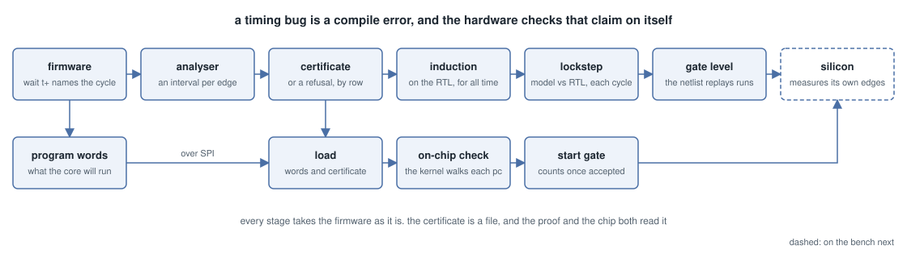

# protocol-emulator

A small chip that bit-bangs protocols from firmware, and a checker that proves the firmware's
timing before it ever runs. Written in Hardcaml for Jane Street's protocol emulator ASIC
competition, built on IHP CMOS5L through Tiny Tapeout, in 6 x 4 tiles at 48 MHz.



Two small cores drive the pins from firmware, much like the RP2040's PIO. The difference is
time. Each core has a 24-bit clock, a deadline register `t` and a period `p`. `wait t+`
releases on the exact cycle of the deadline and moves it on by one period, so a frame never
drifts. A UART bit or an I2C hold time is a deadline written in the program, not a count of
instructions you hope adds up.

Before a program is loaded, a small kernel checks a certificate of its timing and refuses
anything it can't check. The kernel is proved against the RTL. If it accepts a program, that
program never misses a deadline on the chip, under the assumptions in
[What is not proved](verification.md#what-is-not-proved). If a deadline is ever missed
anyway, by firmware that skipped the check, the engine lets go of its pins and halts, and
that is proved too.

Start with [Getting started](getting-started.md), or paste firmware into the playground.

## Elsewhere on the site

<ul>
<li><a href="playground/">Firmware timing playground</a>: the assembler, the timing analyser and the kernel, compiled to JavaScript with js_of_ocaml.</li>
<li><a href="die/">Live die</a>: the hardened die, cells and wires lit as they switch.</li>
<!-- results -->
<li><a href="results/">Results</a>: the claims CI checks, the job that checks each, and its last run on main.</li>
<!-- /results -->
<!-- corpus -->
<li><a href="corpus/">Protocol corpus</a>: each protocol's limits, firmware, certificate and board runs, failures included.</li>
<!-- /corpus -->
<!-- 8x4 -->
<li><a href="8x4/">8x4 tiles</a>: the staged 8x4 chip.</li>
<!-- /8x4 -->
<li><a id="viewer" href="https://gds-viewer.tinytapeout.com/?pdk=ihp-sg13cmos5l&amp;model=https%3A%2F%2Fmarcosash.github.io%2Fprotocol-emulator%2Ftinytapeout.oas">3D viewer</a>: the last green gds run on main in Tiny Tapeout's GDS viewer, also as <a href="tinytapeout.gds">GDS</a> and <a href="tinytapeout.oas">OASIS</a>, and its <a href="gds_render.png">render</a>.</li>
</ul>

```{toctree}
:caption: Start
:maxdepth: 1

getting-started
```

```{toctree}
:caption: Design
:maxdepth: 1

architecture
datasheet
comparison
protocols
```

```{toctree}
:caption: Evidence
:maxdepth: 1

verification
flexibility
ai-use
```

```{toctree}
:caption: Hardware
:maxdepth: 1

hardware
```

```{toctree}
:caption: Site
:maxdepth: 1

Playground <https://marcosash.github.io/protocol-emulator/playground/>
Results <https://marcosash.github.io/protocol-emulator/results/>
Live die <https://marcosash.github.io/protocol-emulator/die/>
Repository <https://github.com/MarcosAsh/protocol-emulator>
```
